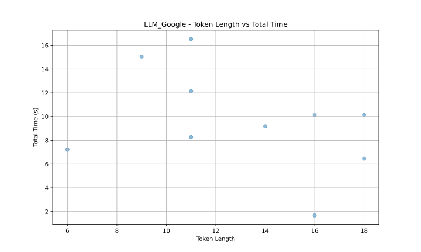
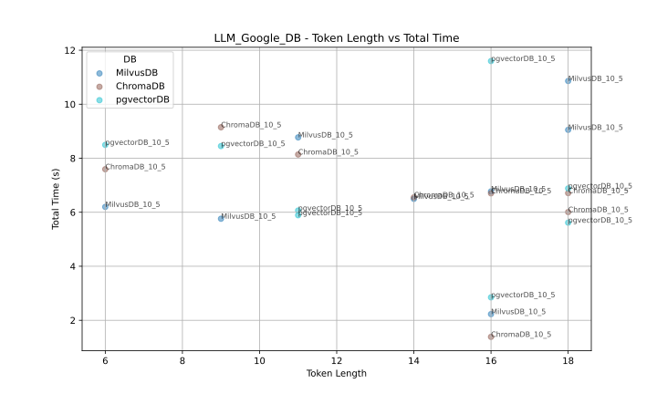
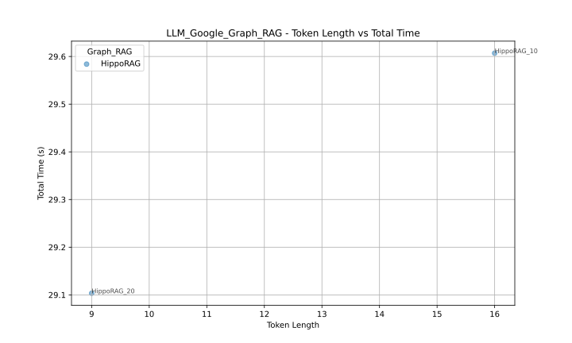

# RAG Comparison Demo

An extensible, configuration-driven framework and lightweight demo for
comparing an LLM-only pipeline with retrieval-augmented variants. The same
question can be sent to several pipelines, and answers, retrieval/reasoning
traces and stage timings can be inspected side by side.

## Features

- Named pipelines selected entirely from JSON config.
- OpenAI-style `/v1/chat/completions` and `/health` endpoints, with streaming
  and non-streaming modes.
- Concurrent web + local retrieval in the augmented pipelines.
- Optional reasoning trace and per-stage timing records.
- Lightweight Gradio UI for side-by-side comparison.
- Offline mock mode with no credentials, model downloads or external services.
- Optional adapters for [Milvus](https://github.com/milvus-io/milvus),
  [Chroma](https://github.com/chroma-core/chroma),
  [pgvector](https://github.com/pgvector/pgvector),
  [HiRAG](https://github.com/HKUDS/HiRAG),
  [LightRAG](https://github.com/HKUDS/LightRAG) and
  [HippoRAG](https://github.com/OSU-NLP-Group/HippoRAG).

## System diagram

```text
                 ┌────────────────────────┐
  question ─────▶│  FastAPI /v1/chat/...  │
                 └───────────┬────────────┘
                             │ RAG_pipeline_type
        ┌────────────────────┼────────────────────┐
        ▼                    ▼                    ▼
  MockPipeline        LLM_Google          LLM_Google_DB / LLM_Google_Graph_RAG
  (offline)           (web search)        (web + vector DB / graph RAG)
        │                    │                    │
        └────────────────────┼────────────────────┘
                             ▼
             {content, reasoning, inference_time}
                             │
                             ▼
                 Gradio side-by-side UI
```

A more detailed description is in [`docs/architecture.md`](docs/architecture.md).

## Visualization

Illustrative timing charts are included under
[`assets/visualization/`](assets/visualization/):

[](assets/visualization/RAG_time.html)
[](assets/visualization/RAG_time.html)
[](assets/visualization/RAG_time.html)

## Dependencies and upstream projects

Core (quick demo): Python 3.10+, [FastAPI](https://fastapi.tiangolo.com/),
[Uvicorn](https://www.uvicorn.org/), [Pydantic](https://docs.pydantic.dev/),
[Gradio](https://gradio.app/) and
[Requests](https://requests.readthedocs.io/).

Optional backends are external projects, not vendored here:

| Category | Projects |
|---|---|
| Graph RAG | [HiRAG](https://github.com/HKUDS/HiRAG), [LightRAG](https://github.com/HKUDS/LightRAG), [HippoRAG](https://github.com/OSU-NLP-Group/HippoRAG), [Neo4j](https://github.com/neo4j/neo4j) |
| Vector DB | [Milvus](https://github.com/milvus-io/milvus), [Chroma](https://github.com/chroma-core/chroma), [pgvector](https://github.com/pgvector/pgvector) |
| Arena UI reference | [FastChat](https://github.com/lm-sys/FastChat) |
| Other | [LangChain](https://github.com/langchain-ai/langchain), HuggingFace embedding/rerank models, matplotlib/seaborn |

See [`docs/backends.md`](docs/backends.md) for the settings each optional
configuration expects.

## Quick Start (offline mock mode)

```bash
git clone https://github.com/slyipae1/rag-comparison-demo.git
cd rag-comparison-demo
python -m pip install -r requirements.txt

# Start both mock pipelines on 127.0.0.1:8024 and 127.0.0.1:8023
bash scripts/run_mock_api.sh

# In another terminal, start the comparison UI on 127.0.0.1:7860
bash scripts/run_ui.sh
```

Open <http://127.0.0.1:7860>, enter one question and press **Compare**. Both
panels show answers, reasoning and measured time.

Alternatively, call the API directly:

```bash
curl -s http://127.0.0.1:8023/v1/chat/completions \
  -H 'Content-Type: application/json' \
  -d '{"messages":[{"role":"user","content":"What is RAG?"}],"stream":false}'
```

## Configuration

| File | Purpose |
|---|---|
| `configs/mock-demo.json` | Two offline pipelines (`mock_llm_only`, `mock_rag`). Safe default. |
| `configs/example.json` | Example settings for the augmented configurations; requires external services. |
| `.env.example` | Placeholder keys/paths. Copy to `.env` locally if needed; never commit real values. |

Every pipeline entry defines `RAG_pipeline_type`, `API_host`, `API_port` and any
backend-specific settings. The API app reads all named entries from one file.
Real deployments should set secrets via environment variables, not JSON.

To run a single named configuration:

```bash
PYTHONPATH=src python -m rag_comparison.api.app \
  --config-file configs/mock-demo.json --config-name "LLM + retrieval (mock)"
```

## Example output

Both pipelines receive the same `messages` payload. A non-streaming response
looks like:

```json
{
  "choices": [{
    "message": {"role": "assistant", "content": "[mock answer] ..."},
    "inference_time": 0.0512,
    "reasoning_process": "## Synthetic retrieval\nSynthetic document #a1b2c3d4 ..."
  }]
}
```

Streaming responses emit the same fields in `choices[0].delta` chunks and end
with `data: [DONE]`. The UI renders the two responses side by side.

## License

MIT — see [`LICENSE`](LICENSE). Third-party attributions are recorded in
[`NOTICE.md`](NOTICE.md). No upstream source trees are vendored in this
repository.
